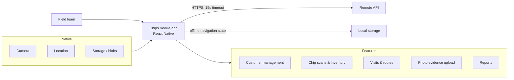

# Chips — Field-Force Mobile App: Security Remediation & Modernization (Showcase)

> Public showcase of a mobile project. **No source code is published here.** This repository documents the architecture, security remediation program, and modernization plan of a private project. Source code and a walkthrough are available on request.

## Overview

Chips is a **React Native field-force application** used by field teams to manage customers, chip inventory, prices, visits, photo evidence, and reports. The project's engineering story is its **security remediation and modernization program**: bringing an unsupported legacy baseline (React Native 0.62.3) under control through documented incident response, implemented security controls, measured dependency debt, and a staged migration plan with explicit exit criteria.

## Highlights

- Real-world field app: customers, chip scans, prices, visits, photo upload, offline-tolerant navigation
- **Security incident handled end-to-end**: embedded credentials removed, tracked in Git history, assigned a formal rotation and evidence-preservation procedure
- Measured dependency debt instead of hiding it: production audit findings quantified and CI-enforced with a debt ceiling
- Implemented Android hardening: HTTPS-only traffic, cleartext disabled, ProGuard + resource shrinking, protected release signing
- Staged modernization roadmap with **explicit exit criteria** before any production release

## Stack

| Layer | Technology |
| --- | --- |
| Mobile | React Native 0.62.3 (legacy baseline), Android |
| Native integrations | Camera, location, storage, blobs, icons, gestures, navigation |
| Backend | Remote API over HTTPS-only transport |
| Quality | Tests, ESLint, bundle checks, secret scanning, quality container in CI |
| Tooling | Node.js 20 quality toolchain, Docker quality container |

## Architecture

**Key decisions:**

- The app is built around offline-tolerant field usage: navigation state survives process restarts and uploads are validated (resource names, methods, identifiers) before leaving the device.
- Every external API call has an explicit timeout and travels exclusively over HTTPS; Android cleartext traffic is disabled platform-wide.
- Release artifacts are generated outside the repository and signed only through the protected release process — the committed debug key is no longer used for releases.

## Security program

The repository documents a complete remediation program, including honest incident accounting:

- **Credential incident**: two static authorization credentials were removed from source. Because they remain recoverable from Git history and previously distributed APKs, the security policy mandates rotation at the issuing systems, log review for unexpected use, evidence preservation, and artifact purging before any release.
- **Secret scanning with a documented allowlist**: the history scanner contains a narrow allowlist for the known incident file so CI can distinguish the documented, tracked incident from *new* leaks — the allowlist is explicitly stated to not imply the exposed credentials are safe.
- **Shared-secret removal**: the protocol's shared client authorization is slated for replacement with a backend gateway or short-lived, user-scoped tokens.
- **Measured dependency debt**: the production audit at this baseline reports 11 critical / 19 high / 10 moderate / 2 low findings, mostly rooted in the unsupported React Native 0.62 toolchain. CI runs `audit:ceiling` so any *increase* above this recorded debt fails the build — release remains blocked until findings are eliminated or formally accepted by the system owner.

## Modernization roadmap

A staged migration plan (documented in `MIGRATION.md`) sequences the work:

1. **Behavior preservation** — tests covering authentication, customer selection, chip scans, prices, visits, photo upload, offline navigation state, and error handling
2. **Native inventory** — catalog Android/iOS integrations (camera, location, storage, blobs, gestures, navigation)
3. **Dependency replacement** — deprecated router-flux, async storage, blob fetching, and git-based camera packages swapped for maintained ones
4. **Incremental React Native upgrade** — official upgrade diffs, smoke-tested at each stepping stone
5. **Auth redesign** — backend gateway or short-lived user-scoped token flow
6. **Android platform updates** — Gradle, SDK, signing, backup, network security, and privacy declarations
7. **Device-level testing** — permissions, camera capture, uploads, process restart, deep links, poor connectivity
8. **Release gate** — zero high/critical production findings, or explicit time-bounded risk acceptance by the owner

**Exit criteria:** maintained framework and modules, all quality checks green, device smoke tests on supported OS versions, rotated credentials with no shipped static secrets, resolved (or formally accepted) vulnerabilities, and signed release artifacts from the protected release process.

## Skills demonstrated

React Native, mobile security remediation, incident response for leaked credentials, secret scanning strategy, dependency risk management with CI enforcement, Android hardening (HTTPS-only, ProGuard, protected signing), legacy framework migration planning, offline-first field app design, engineering documentation discipline.

---

*This is a documentation-only showcase. The private repository contains the full implementation: React Native app, native integrations, tests, CI workflows, and the complete security and migration documentation.*
